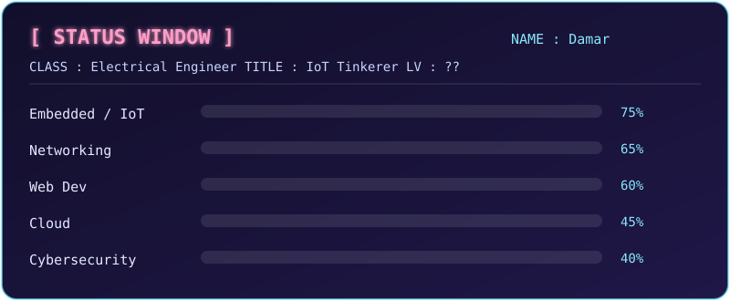

<!-- ============ HEADER ============ -->
<div align="center">

</div>

<div align="center">

<a href="https://git.io/typing-svg">
  
</a>

<br/>


<br/><br/>

<a href="https://www.linkedin.com/in/dmradhdyo/"></a>
<a href="https://instagram.com/dmradhdyo"></a>
<a href="https://x.com/dmradhdyo"></a>
<a href="mailto:dmradhdyo@gmail.com"></a>

</div>



## 🌸 自己紹介 • Tentang Aku

```ts
const damar = {
  status: "Mahasiswa Teknik Elektro",
  fokus: ["IoT", "Embedded Systems", "Network Engineering"],
  eksplorasi: ["Cloud Computing", "Cybersecurity"],
  sedangDikerjakan: "Smart Container System berbasis IoT 📦",
  sedangDipelajari: ["Embedded", "Web Dev", "Network Security"],
  hobi: ["Olahraga 🥊", "Membaca 📚", "Kuliner 🍜"],
  funFact: "Lebih milih nasi berubah jadi protein daripada ngerjain Laprak 😅",
  terbukaUntuk: "Kolaborasi proyek IoT, Embedded & Elektronika",
};
```


## ⚔️ ステータス • Status Window

<div align="center">
  
</div>


## 🛠️ 装備 • Tech Stack

<div align="center">

**Bahasa & Web**


**Embedded, Cloud & Tools**


**Data & Kreatif**


</div>


## 📊 統計 • GitHub Stats

<div align="center">


<br/>


<br/>


</div>


## 🤝 一緒に作ろう • Ayo Kolaborasi!

<div align="center">

Tertarik proyek **IoT**, **Embedded Systems**, atau **Elektronika**?
Hubungi aku di [dmradhdyo@gmail.com](mailto:dmradhdyo@gmail.com) atau lewat [LinkedIn](https://www.linkedin.com/in/dmradhdyo/).

<a href="https://git.io/typing-svg">
  
</a>

</div>


